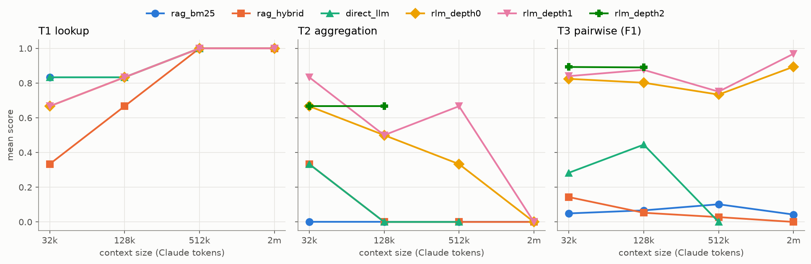
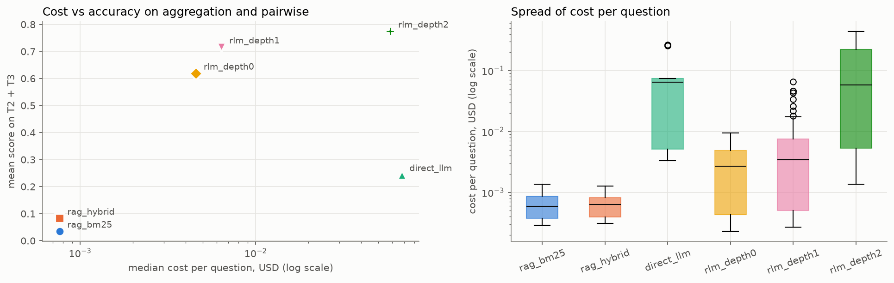

# Recursive Language Models vs RAG on E-commerce Delivery Data

**A replication of the RLM idea on a new domain** · Claude Haiku 5.5 · October 2026<br>
Live results: <https://rlm-vs-rag-logistics-demo.vercel.app> · Code: <https://github.com/Prerna-02/rlm-vs-rag-logistics>

## Summary

We compared six ways for a language model to answer questions over up to 2 million tokens of real e-commerce records
(Olist, Brazil): two retrieval-augmented generation (RAG) variants, a direct long-context call, and a Recursive Language
Model (RLM) at recursion depths 0, 1 and 2. The benchmark has three question types whose work grows differently with
context size: single-record lookups, aggregations over every matching record, and pairwise comparisons.

* **Lookups:** every method does well; RAG with BM25 is the most accurate (0.90) and the cheapest.
* **Aggregation and pairwise questions:** RAG scores at most 0.10 and 0.07; direct LLM 0.15 and 0.34, falling to 0 at 512K.
  RLM depth 1 scores 0.60 and 0.84 and degrades slowest as the context grows.
* **Cost:** RLM depth 1's median cost per question ($0.0034) is ~6× RAG's but ~20× below direct LLM's, with a long tail
  (90th percentile ~7× its median).
* **Recursion:** depth 2 matched depth 1 (0.77 vs 0.76 on the same questions) at ~10× the median cost and ~13× the time.

## 1. Background

LLMs lose accuracy as their input grows ("context rot"). RAG avoids long inputs by retrieving a few relevant chunks, which
works when the answer lives in a few places but cannot work when the answer depends on *every* record. Zhang, Kraska &
Khattab (*Recursive Language Models*, MIT) propose keeping the input out of the prompt entirely: it is stored as a variable in
a Python REPL, the model writes code to explore it, and it may call sub-models (or sub-RLMs) on slices. This project tests
that claim on a domain with structured delivery data mixed with free-text Portuguese reviews.

## 2. Data

The [Olist Brazilian E-Commerce dataset](https://www.kaggle.com/datasets/olistbr/brazilian-ecommerce) (~100K orders,
2016-2018). Orders, items, sellers, customers, products and reviews were joined into one record per order, keeping
delivered, single-seller orders (95,195), of which 38,078 have a written review. Each record is one line:

```
[order O58113] seller=S1642 (SC/blumenau) customer=SP/valinhos category=computers_accessories purchased=2018-02-21
estimated=2018-03-16 delivered=2018-03-09 (7 days early) review=3/5 "Satisfeito"
```

Long hexadecimal ids were replaced by short ones (`O58113`, `S1642`), cutting ~17% of the characters per record.
Records were shuffled once (seed 42) and stacked into **nested** contexts, measured with Claude's own tokenizer:

| Context | Orders | Claude tokens |
|---|---|---|
| 32K | 269 | 31,961 |
| 128K | 1,083 | 127,891 |
| 512K | 4,351 | 511,949 |
| 2M | 17,030 | 1,999,879 |

Nesting means each context is a prefix of the next, so differences between sizes come from the amount of text alone.

## 3. Benchmark

### 3.1 Answer key
Every review in the 2M context (17,030) was labeled with its main complaint, **delivery**, **product**, **seller_service**,
**positive** or **other**, by Claude Haiku 5.5 through the Batch API, using written definitions plus six decision rules.
A blind human audit of 200 random reviews (with LLM translations; the auditor did not see the model's labels) gave
**83.9%** agreement at first. The disagreements showed ambiguous definitions (e.g. "never arrived" vs "seller didn't reply"),
so six rules were agreed, the reviews re-labeled, and the audit re-scored at **93.0%**, above the 90% gate. In that
re-scoring, 19 audit labels were edited by applying the same rules; the original human labels are kept alongside, and
agreement against them is 83.4%. Answers are then computed exactly from the labels with pandas, so the key is reproducible
(`scripts/verify_answer_key.py` rebuilds it from raw data).

### 3.2 Questions
The three tiers mirror the paper's benchmarks:

| Tier | Mirrors | Example | Work vs size | Scoring |
|---|---|---|---|---|
| T1 lookup | S-NIAH | "What is the main complaint in the review of order O39999?" | constant | exact label |
| T2 aggregation | OOLONG | "Among orders delivered after the estimated date, what % of reviews are delivery complaints?" | linear | within 2 points, or one order's worth (100/n) for small groups |
| T3 pairwise | OOLONG-Pairs | "Among orders whose customer is in RJ, list every pair from the same city where one is a delivery and the other a product complaint." | quadratic | F1 over pairs |

Six questions per tier at 32K, 128K and 512K, two per tier at 2M: **59 questions**. Questions are generated by code from
fixed templates; T3 scopes are chosen so each answer has 3-60 pairs.

## 4. Methods

All methods share one system prompt (record format, the same label definitions, "end with `ANSWER:`") and run on
**Claude Haiku 5.5**.

| Method | What the model sees |
|---|---|
| RAG · BM25 | the 20 records ranked highest by keyword search (BM25) |
| RAG · hybrid | the top 20 after reciprocal-rank fusion of BM25 and dense retrieval (`multilingual-e5-small`) |
| Direct LLM | the whole context in one prompt (≤ 1M tokens, so not at 2M) |
| RLM depth 0 | the question; the context is a REPL variable explored with code only |
| RLM depth 1 | as depth 0, plus `llm_query()` sub-calls on slices |
| RLM depth 2 | as depth 1, but each sub-call is itself an RLM |

The RLM is built from scratch (~200 lines): a restricted namespace (no files or network, import allow-list), a time limit
checked on every bytecode instruction, at most 12 root turns and 60 sub-calls, and a per-question cost cap. One harness
fix came from testing: a model sometimes wrote code *and* an invented output in the same reply, then answered from the
invented output; a typed `FINAL` next to code blocks is now ignored until the real output has been seen.
The authors' `rlms` library was run on the same questions as a reference (notebook 07).

**Grid.** Every method ran on every question, except direct LLM at 2M (impossible) and at 512K (one question per tier,
for cost), and depth 2 (T2/T3 at 32K and 128K). Total: **297 runs**, one run per question.

## 5. Results

### 5.1 Overall

| Method | T1 lookup | T2 aggregation | T3 pairwise | Median $ / question | Median time |
|---|---|---|---|---|---|
| RAG · BM25 | **0.90** | 0.00 | 0.07 | $0.0006 | 4 s |
| RAG · hybrid | 0.70 | 0.10 | 0.06 | $0.0006 | 3 s |
| Direct LLM | 0.85 | 0.15 | 0.34 | $0.065 | 16 s |
| RLM depth 0 | 0.85 | 0.45 | 0.80 | $0.0027 | 18 s |
| RLM depth 1 | 0.85 | **0.60** | 0.84 | $0.0034 | 23 s |
| RLM depth 2 (subset) | — | 0.67 | **0.89** | $0.059 | 7.8 min |

### 5.2 RQ1 · Accuracy as the context grows



Mean score on T2 + T3 (the questions that need every record):

| Method | 32K | 128K | 512K | 2M |
|---|---|---|---|---|
| RAG · BM25 | 0.02 | 0.03 | 0.05 | 0.02 |
| RAG · hybrid | 0.25 | 0.03 | 0.01 | 0.00 |
| Direct LLM | 0.31 | 0.22 | 0.00 | — |
| RLM depth 0 | 0.74 | 0.65 | 0.53 | 0.45 |
| RLM depth 1 | 0.84 | 0.69 | 0.71 | 0.48 |
| RLM depth 2 | 0.77 | 0.78 | — | — |

**Supported.** Direct LLM degrades fastest and cannot run at 2M; RLM degrades slowest. RAG is near zero at every size: it
does not degrade because it never had the information.

### 5.3 RQ2 · Question type
**Supported.** On lookups RAG matches or beats RLM. On aggregation and pairwise questions only RLM is usable. Direct LLM
partly handles pairwise questions at small sizes (0.44 at 128K) but drops to 0 at 512K.

### 5.4 RQ3 · Does recursion matter?
**Partly.** The REPL alone does most of the work (depth 0 already reaches 0.80 on T3). One level of sub-calls helps
aggregation (T2 0.45 → 0.60), where reviews must be read in bulk. Depth 2 adds almost nothing on the same 23 questions
(0.77 vs 0.76) at ~10× the median cost, ~13× the time, and with runaway runs.

### 5.5 RQ4 · Cost



**Supported.** RLM's median cost stays within a small multiple of RAG's, far below direct LLM, but its distribution has a
long tail: depth 1's 90th percentile is ~7× its median, and depth 2 reached $0.44 on one question. Direct LLM is both the
most expensive per question and the least accurate on the hard tiers.

### 5.6 RQ5 · How RLMs fail
Every RLM run that was not fully correct, in one category each:

| Failure | Depth 0 | Depth 1 | Depth 2 |
|---|---|---|---|
| Near miss (label disagreement with the key) | 12 | 15 | 6 |
| Wrong answer | 16 | 9 | 0 |
| Runaway sub-calls (≥ 30 calls or ≥ $0.10) | 0 | 0 | 6 |
| Code errors (≥ 3 tracebacks) | 1 | 1 | 0 |
| Gave up / out of turns | 0 | 1 | 0 |

**Partly supported.** The dominant failure is not broken code but small disagreements in judgment: the root model writes its
own labeling instructions for the sub-model, and a few reviews come out differently from the answer key. Runaway sub-calls
appear only at depth 2. One depth-1 run chose batches of 100 reviews for a 3,895-order question, ran out of turns after
1,900, and correctly reported that it could not finish: a bad first decomposition.

**Where everything failed:** both T2 questions at 2M (2,800 and 15,300 matching orders) exceeded what an RLM can read within
12 turns and 60 sub-calls. Bigger batches or higher caps would be needed at that scale.

## 6. Limitations

* One model (Claude Haiku 5.5), one run per question, 6 questions per cell (2 at 2M): differences of a few points are noise.
* The answer key is LLM-labeled; the human audit covers 200 reviews, and the labeling rules were sharpened on the same
  sample used to score them.
* Mid-run, three direct-LLM runs were moved ahead of the remaining depth-2 runs (order only, no settings changed).
* The data is e-commerce last-mile delivery, not freight or port logistics.

## 7. Reproducibility

```bash
uv sync && cp .env.example .env                 # add KAGGLE_API_TOKEN (+ ANTHROPIC_API_KEY, BUDGET_USD for paid runs)
uv run python scripts/download_data.py
uv run python scripts/verify_answer_key.py      # rebuilds all 59 questions and answers from raw data: no API calls
uv run python scripts/run_grid.py --dry-run     # cost estimate for re-running the experiments
```

A fresh clone reproduces the answer key exactly and passes the test suite (20 tests). Every run, with its full RLM
trajectory, is in `results/runs/`.

## References

* A. Zhang, T. Kraska, O. Khattab. *Recursive Language Models.* [arXiv:2512.24601](https://arxiv.org/abs/2512.24601) · [code](https://github.com/alexzhang13/rlm)
* Olist. *Brazilian E-Commerce Public Dataset.* Kaggle, CC BY-NC-SA 4.0.
